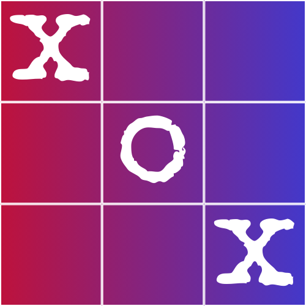

<p align="center">
    
</p>

<h3 align="center">Endless Tic-Tac-Toe — Multiplayer</h3>

<p align="center">
    The <a href="https://github.com/Kenjirl/endless-tic-tac-toe">Endless Tic-Tac-Toe</a> rules, now playable online on two devices with a room code.
</p>

---

## How to play

- Like ordinary Tic-Tac-Toe: get three in a row to win. X moves first.
- Each player keeps at most **3 pieces** on the board.
- When you have 3, your oldest piece changes color (red for X, blue for O): it disappears on your next move.
- The board never fills up, so someone always wins eventually.

### Online
1. **Create a room** → you get a 4-character code (e.g. `K7QM`) and a link.
2. Your friend opens the link or types the code under **Join**.
3. Play. After a game, both press **Rematch**; sides swap so each player gets to move first.

If your connection drops, the game reconnects on its own and keeps your seat (refreshing the tab is fine).
If a player stays offline for 60 seconds mid-game, they forfeit.

### Same device
**Play on this device instead** gives the original two-players-one-screen game.

### Keyboard
| Player X | Board | Player O |
|:-:|:-:|:-:|
| `q w e` | `1 2 3` | `u i o` |
| `a s d` | `4 5 6` | `h j k` |
| `z x c` | `7 8 9` | `b n m` |

Online, you can use your side's letter block or the number keys.

## How it works

```
 Device A ──┐   WebSocket   ┌──────────────────────┐   WebSocket   ┌── Device B
            └──────────────▶│  Room "K7QM"         │◀──────────────┘
                            │  (Durable Object)    │
                            │  · authoritative     │
                            │    game state        │
                            │  · validates moves   │
                            │  · broadcasts state  │
                            └──────────────────────┘
                         Cloudflare Workers + Durable Objects
```

- The **server owns the game**. Browsers send "I want cell 4"; the room validates it with the shared engine and sends the full new state to both players. No desync, no cheating from DevTools.
- Each room code maps to one **Durable Object** instance (`idFromName(code)`), which keeps the state in its storage and holds both WebSockets (Hibernation API, so idle rooms cost nothing).
- Rooms with nobody connected are deleted after 30 minutes.

### Project layout

```
shared/engine.ts      Game rules (pure functions), used by browser and server
shared/engine.test.ts Unit tests for the rules
shared/protocol.ts    Message types, room code format, close codes
worker/index.ts       HTTP routes: POST /api/rooms, GET /api/rooms/:code/ws
worker/room.ts        Room Durable Object: seats, moves, rematch, forfeits, cleanup
app/main.ts           UI: lobby, local mode, online mode
app/net.ts            WebSocket with automatic reconnect
app/board.ts          Board rendering + keyboard mapping
app/fx.ts             Sounds and confetti
index.html            Page markup (Tailwind CSS v4)
```

## Development

Requires Node.js 20+.

```bash
npm install
npm run dev        # Vite + local Worker/Durable Objects at http://localhost:5173
```

Open two browser tabs (or a phone on the same Wi-Fi via the "Network" URL Vite prints) to play against yourself.
Each tab gets its own seat. The token lives in `sessionStorage`.

> If the page hangs on load after you edit `index.html` or `vite.config.ts`, stop and restart `npm run dev`.
> Vite's in-process restart sometimes leaves pre-bundled dependency requests hanging.

Other scripts:

```bash
npm test           # engine unit tests (Vitest)
npm run typecheck  # client + worker
npm run build      # production build into dist/
npm run cf-typegen # regenerate worker-configuration.d.ts after editing wrangler.jsonc
```

## Deploy (Cloudflare)

```bash
npx wrangler login
npm run deploy
```

This builds the client and deploys the Worker, static assets and the `Room` Durable Object in one go.
You get a `https://endless-tic-tac-toe-multiplayer.<your-subdomain>.workers.dev` URL; a custom domain can be added in the Cloudflare dashboard.
The Workers Free plan covers SQLite-backed Durable Objects, which is plenty for casual play.
